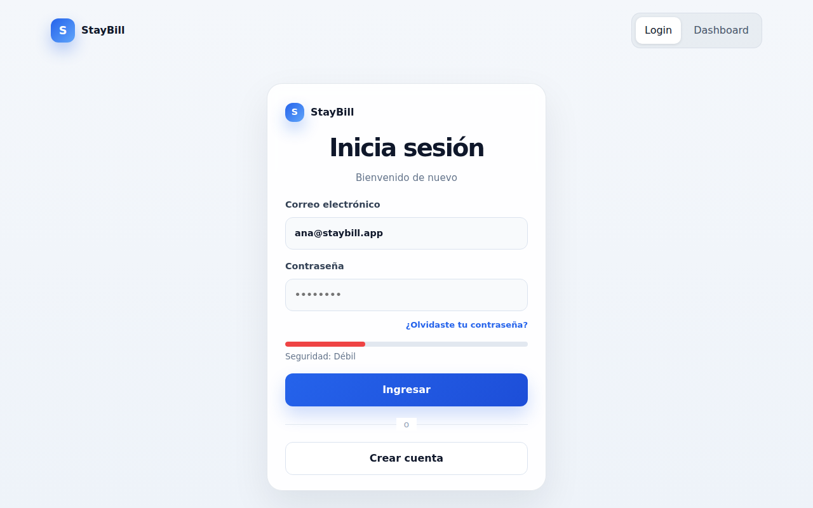
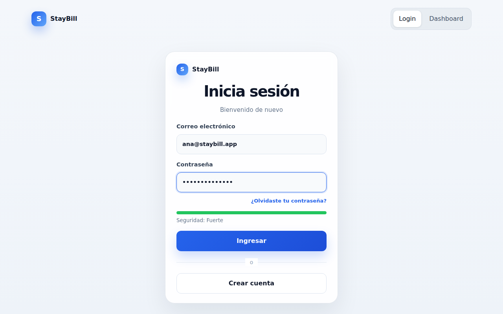
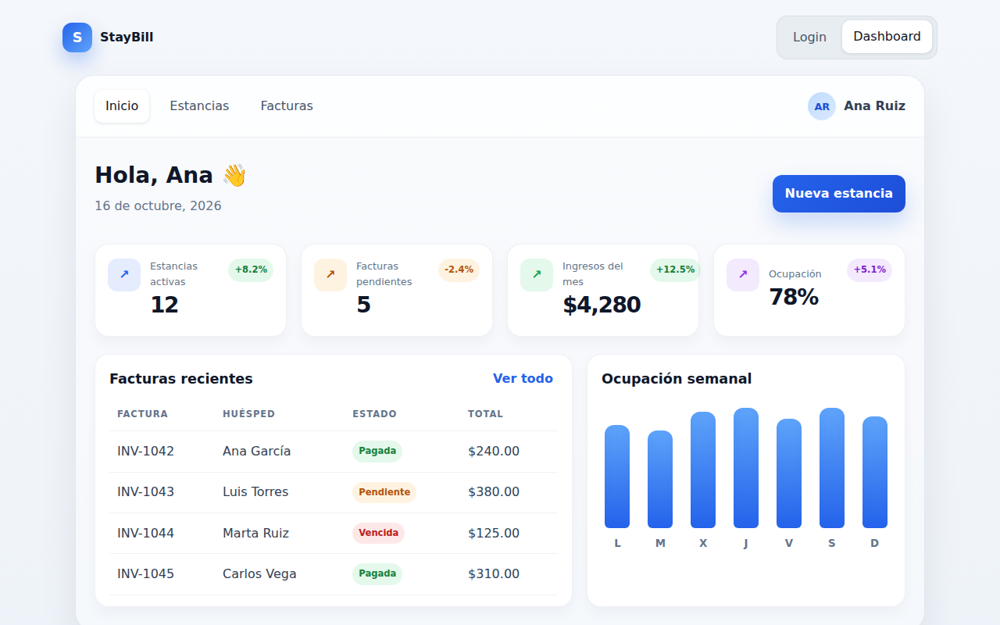
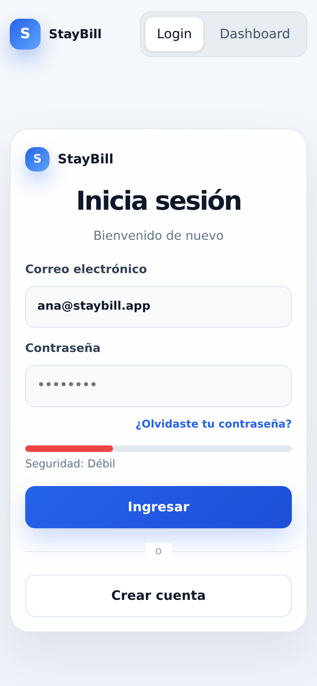
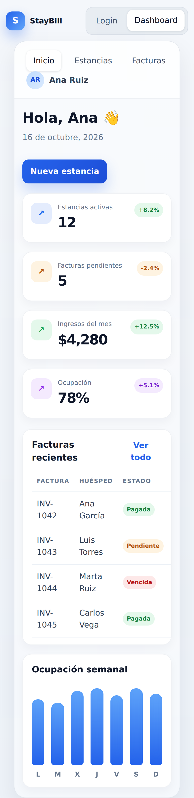

# StayBill

Aplicación cliente-servidor para la gestión de estancias y facturación, creada como proyecto de aprendizaje. El objetivo es construir una API con **registro** y **autenticación** de usuarios, desplegarla detrás de un proxy inverso y, más adelante, evaluar Supabase.

## Capturas de pantalla

### Escritorio

#### Inicio de sesión



#### Inicio de sesión con indicador de seguridad de contraseña

El formulario muestra la fortaleza de la contraseña mientras se escribe (en esta captura: "Fuerte").



#### Dashboard



### Móvil

La interfaz es responsiva y se adapta a pantallas pequeñas.

<table>
  <tr>
    <td align="center"><b>Inicio de sesión</b></td>
    <td align="center"><b>Dashboard</b></td>
  </tr>
  <tr>
    <td></td>
    <td></td>
  </tr>
</table>

> **Nota:** la interfaz web es por ahora una maqueta visual. Los datos del dashboard (facturas, ocupación, ingresos) son de ejemplo, el formulario de login aún no está conectado al backend y las pestañas "Estancias" y "Facturas" todavía no tienen una vista propia.

## Estructura del proyecto

```
staybill/
├── staybill/                  # Backend (API REST)
│   └── src/main/java/com/api/staybill/
│       ├── controller/        # AuthController
│       ├── service/           # AuthService
│       ├── repository/        # UsuarioRepository
│       └── model/             # Usuario (entidad JPA)
├── frontend-app-ing-web/      # Frontend (build de producción en dist/)
└── docs/img/                  # Capturas usadas en este README
```

## Tecnologías

| Capa | Tecnología |
|------|------------|
| Backend | Java 25, Spring Boot 4.1.1 (Web MVC, Data JPA, Security) |
| Base de datos | PostgreSQL (el `pom.xml` también incluye el driver de MySQL) |
| Pruebas | H2 en memoria, Spring Boot Test |
| Frontend | React + Vite (build en `frontend-app-ing-web/dist`) |
| Proxy (planeado) | Caddy (redirección y certificados SSL) |
| Contenedores (planeado) | Docker |

## Requisitos previos

- JDK 25
- PostgreSQL en ejecución con una base de datos llamada `staybill`
- Node.js (solo si quieres servir el frontend con `npx`)

## Configuración

La conexión a la base de datos está en `staybill/src/main/resources/application.properties`:

```properties
spring.datasource.url=jdbc:postgresql://localhost:5432/staybill
spring.datasource.username=postgres
spring.datasource.password=12345
spring.jpa.hibernate.ddl-auto=update
```

Crea la base de datos antes de arrancar:

```sql
CREATE DATABASE staybill;
```

Hibernate crea la tabla `usuarios` automáticamente (`ddl-auto=update`).

> ⚠️ Cambia el usuario y la contraseña por los de tu entorno y evita subir credenciales reales al repositorio.

## Cómo ejecutar

### Backend

```bash
cd staybill/staybill
./mvnw spring-boot:run        # En Windows: mvnw.cmd spring-boot:run
```

La API queda disponible en `http://localhost:8080`.

### Frontend

El repositorio contiene el build ya generado en `frontend-app-ing-web/dist`. Para verlo:

```bash
cd frontend-app-ing-web/dist
npx serve .                   # o: python -m http.server 5173
```

## API

### `POST /api/auth/registro`

Registra un usuario nuevo.

**Cuerpo de la petición**

```json
{
  "nom_usu": "Ana Ruiz",
  "correo_usu": "ana@staybill.app",
  "pass_usu": "miClaveSegura"
}
```

**Ejemplo con curl**

```bash
curl -X POST http://localhost:8080/api/auth/registro \
  -H "Content-Type: application/json" \
  -d '{"nom_usu":"Ana Ruiz","correo_usu":"ana@staybill.app","pass_usu":"miClaveSegura"}'
```

**Modelo `Usuario`** (tabla `usuarios`)

| Campo | Tipo | Descripción |
|-------|------|-------------|
| `id_usu` | `Long` | Identificador autogenerado |
| `nom_usu` | `String` | Nombre del usuario |
| `correo_usu` | `String` | Correo (único, obligatorio) |
| `pass_usu` | `String` | Contraseña |
| `rol_usu` | `String` | Rol, por defecto `USER` |
| `estado_usu` | `Boolean` | Activo, por defecto `true` |

## Estado actual y próximos pasos

- [x] Endpoint de registro de usuarios
- [x] Persistencia en PostgreSQL con JPA
- [x] Maqueta de la interfaz web (login y dashboard)
- [ ] Endpoint de **autenticación** (login)
- [ ] Cifrar contraseñas (por ejemplo con `BCryptPasswordEncoder`); actualmente se guardan tal como llegan
- [ ] Configurar Spring Security (reglas de acceso, JWT o sesiones)
- [ ] Conectar el frontend con la API
- [ ] Caddy como proxy inverso con certificados SSL automáticos
- [ ] Dockerizar backend, base de datos y proxy
- [ ] Evaluar Supabase
- [ ] Investigar Nginx y la redirección de puertos

## Notas de aprendizaje

Objetivos originales del proyecto:

- Crear una API cliente-servidor con autenticación y registro.
- Usar Java con Spring Boot (o Node.js).
- Usar Caddy para el redireccionamiento de proxys (gestiona certificados SSL).
- Usar Docker, aunque no sea imprescindible, con fines de aprendizaje.
- Después, explorar Supabase.
- Investigar Nginx y el direccionamiento de puertos.
